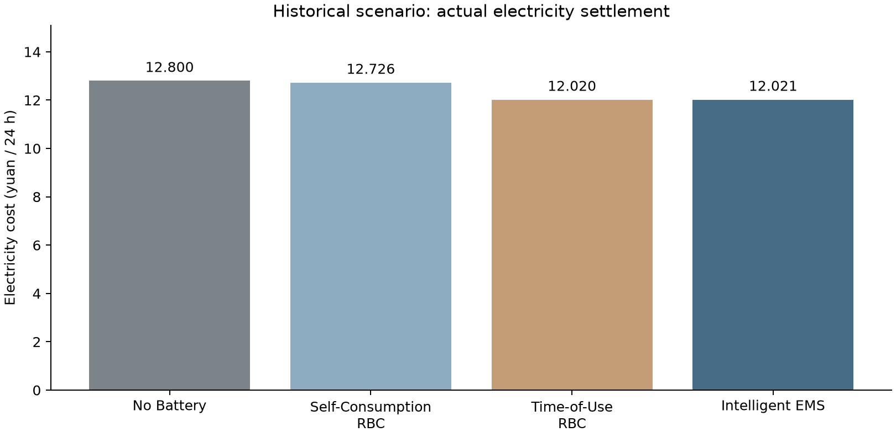
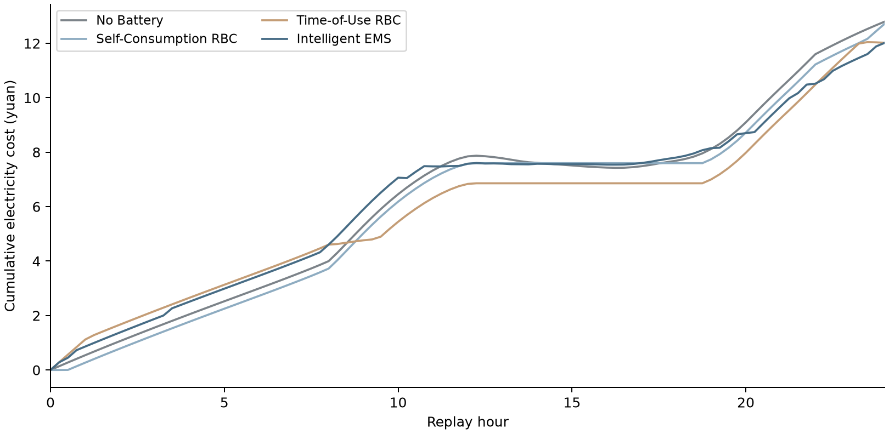
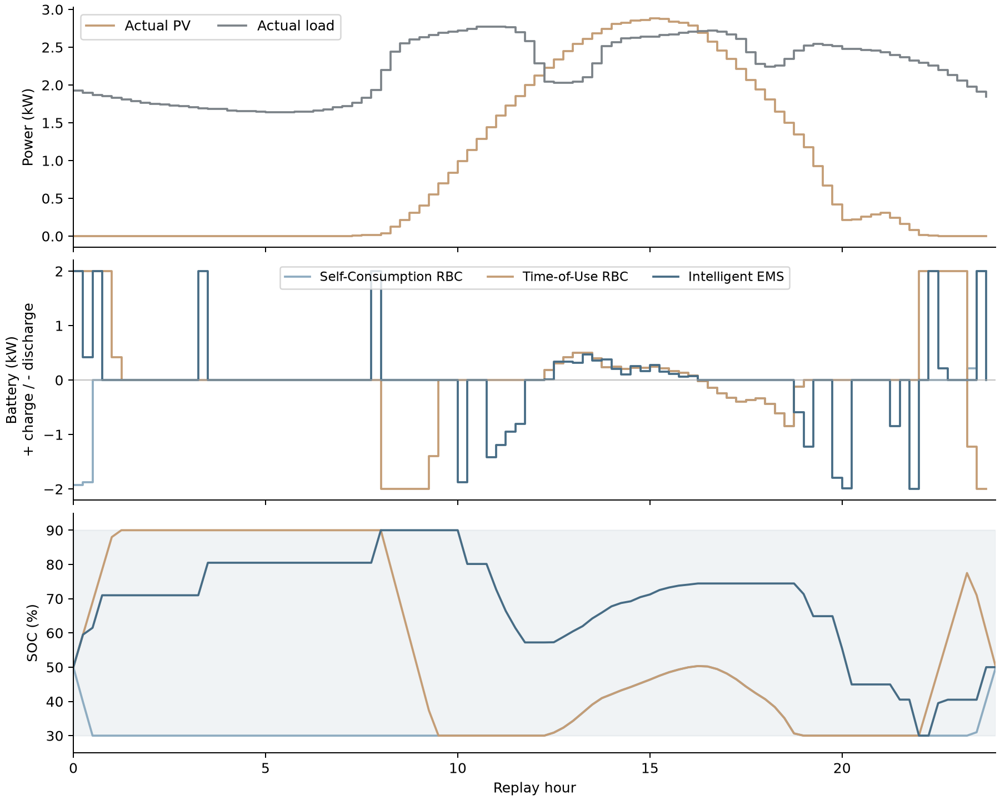

# EMS Economic Impact Evaluation

## Setup

- **Scope:** one 24-hour replay with 96 fifteen-minute intervals. PV: Gansu CSV, 96-point block 501, first timestamp: 2008-05-16T00:00:00Z. Load: Quanzhou CSV, day 91, first timestamp: 2016-03-31 00:00:00. Data from different regions and years are aligned by interval. This is a scaled offline scenario, not a measured site bill or an annual savings estimate.
- **Data preparation:** reuse `backend.data.prepare_scenario`. Scale PV and load separately to 3 kW using only the preceding seven-day peaks; cap PV at 3 kW. No observations are synthesized, and no model is retrained or fitted to the evaluation day. The PV day follows all 500 days used by the training script. Load uses the last complete test day.
- **Source coverage:** PV spans 2007-01-02 00:00 to 2020-10-06 22:45 UTC (482,588 rows). Load spans 2016-01-01 to 2016-03-31 (8,736 rows). Both use fifteen-minute samples. The replay day and preceding seven days pass continuity checks. Existing artifacts contain weights and prediction plots, but no reusable forecast table with issue times, so forecasts are recomputed by inference.
- **Equipment:** a 5 kWh battery, 2 kW charge/discharge limits, 95% efficiency in each direction (90.25% round trip), and 30–90% SOC. Initial and final SOC both equal 50%. All scenarios use 5 kW import and 3 kW export limits. Excess PV is curtailed. Simultaneous charging/discharging and importing/exporting are prohibited.
- **Tariff:** reuse CSV prices in yuan/kWh. Imports cost 0.288 during 00:00–08:00 and 22:00–24:00, and 0.568 otherwise. Exports earn 0.4153. Bills include energy only; demand charges, fixed fees, and taxes are excluded because supporting tariff data are unavailable.
- **Export assumption:** stored energy may be exported under the existing model. Off-peak imports are cheaper than exports, allowing grid-to-battery-to-grid arbitrage. Contract eligibility has not been verified; savings are conditional on this assumption.
- **Rule-based control (RBC):** self-consumption RBC charges from PV surplus and discharges into deficits. Time-of-use (TOU) RBC charges at the lowest import price and discharges into deficits at the highest price. Other intervals prioritize direct PV use. Thresholds come from the tariff, without tuning on replay results.
- **Intelligent EMS:** reuse pretrained PV LSTM-Transformer and load LSTM models with the existing Gurobi MILP optimizer. Reoptimize the remaining day at each interval and execute only the first action. Use the cost objective, disable the default 1.5 kW soft import target, and retain existing physical constraints.
- **Causality:** slot 0 uses day-ahead forecasts. At slot t, residual correction uses only observations through slot t−1. Current and future actuals never enter the optimizer. Current net load is used only for common actuator limits and settlement. The replay uses interval-average power and does not simulate faster device dynamics.
- **Equal endpoints:** a common reachable-energy envelope returns every battery scenario to its initial 50% SOC. Recovery imports and exports are billed. This envelope can override RBC actions; no separate terminal-energy credit is added.
- **Accounting:** bill = sum of 0.25 × (actual imports × import price − actual exports × export price). Battery aging is excluded. The optimizer retains its 0.005 yuan/kWh throughput penalty as a regularizer, reported separately rather than treated as measured degradation cost.

## Comparison

Negative savings indicate a higher bill than the reference. Each percentage uses its reference bill as the denominator.

| Scenario | Electricity Cost (yuan) | Reduction vs No Battery (%) | Savings vs SC RBC (%) | Savings vs TOU RBC (%) | Peak Import (kW) | PV Self-Consumption (%) |
|---|---:|---:|---:|---:|---:|---:|
| No Battery | 12.8003 | 0.00 | -0.59 | -6.49 | 2.339 | 95.14 |
| Self-Consumption RBC | 12.7257 | 0.58 | 0.00 | -5.87 | 3.911 | 96.91 |
| Time-of-Use RBC | 12.0198 | 6.10 | 5.55 | 0.00 | 4.283 | 97.80 |
| Intelligent EMS | 12.0207 | 6.09 | 5.54 | -0.01 | 4.250 | 97.22 |

PV self-consumption is **PV energy delivered to load / total PV generation**. PV serves load first; surplus can charge the battery. Stored PV is tracked proportionally, and initial inventory has no PV origin. Losses, battery exports, and unused terminal PV inventory are excluded. This avoids counting grid charging as PV use and differs from 1 − total exports / PV generation.

| Scenario | Import (kWh) | Export (kWh) | Throughput Proxy (yuan) | Final SOC | Final PV Inventory (kWh) | Adjusted Slots | Violations |
|---|---:|---:|---:|---:|---:|---:|---:|
| No Battery | 32.216 | 1.070 | 0.0000 | — | 0.0000 | 0 | 0 |
| Self-Consumption RBC | 31.353 | 0.000 | 0.0202 | 50.00% | 0.6059 | 69 | 0 |
| Time-of-Use RBC | 31.760 | 0.060 | 0.0540 | 50.00% | 0.3909 | 61 | 0 |
| Intelligent EMS | 31.824 | 0.282 | 0.0387 | 50.00% | 0.3245 | 0 | 0 |

Adjusted slots reflect actuator, import, or endpoint corrections, not constraint violations. Checks cover SOC, power, grid capacity, balance, energy recursion, mutually exclusive actions, curtailment, and terminal energy (tolerance 1e−5). Per-slot checks are in `dispatch.csv`.

## Figures

Bills use identical actuals and settlement periods. This single-day comparison has no statistical error bars.

All curves start at zero and include endpoint recovery costs.

Top: actual PV and load. Middle: battery power, positive for charging and negative for discharging. Bottom: continuous SOC; shading marks the allowed range.

## Findings and limits

- Battery plus EMS saved **0.7795 yuan over 24 hours (6.09%)** versus no battery.
- EMS saved **0.7050 yuan (5.54%)** versus self-consumption RBC. Its bill differed from TOU RBC by **+0.000960 yuan (+0.008%)**. Positive differences mean EMS cost more. This sub-cent difference does not establish a robust ranking.
- Peak import changed from 2.339 to 4.250 kW (**+81.69%**). PV self-consumption changed from 95.14% to 97.22% (**+2.07 percentage points**). Minimizing energy cost does not guarantee peak reduction; cheap charging and endpoint recovery can raise peaks.
- Including the throughput proxy gives 12.0738 yuan for TOU RBC and 12.0594 yuan for EMS. The proxy can change the objective ranking, but it is not measured aging cost or proof of the sole cause of the bill difference.
- No battery to self-consumption RBC saved 0.0746 yuan, combining battery availability with that rule. Comparisons with EMS measure the combined effect of forecasting and rolling optimization. Separate ablations are needed to isolate either component. Results also depend on tariff and battery-export assumptions.
- One existing test day cannot establish seasonal reliability, annual returns, or real-contract savings. Capital, maintenance, and measured aging costs are excluded.

**CV summary:** Built a causal 15-minute replay benchmark using pretrained LSTM forecasts and Gurobi rolling optimization. Reduced electricity cost by 6.09% versus no battery and 5.54% versus self-consumption RBC, with 0 constraint violations. Results cover one scaled offline day with equal battery endpoints; the EMS–TOU bill difference was +0.008%.

## Reproduction and audit

Run `python -m scripts.economic_evaluation` from the project root with the project environment activated. Existing model weights, CSV inputs, Python dependencies, and a working Gurobi license are required. No training is performed. The script writes this report and `results/economic_evaluation/` without changing application services.

- `comparison.csv`: scenario metrics.
- `dispatch.csv`: per-slot settlement and constraint checks for all four scenarios.
- `forecast_audit.csv`: forecasts and issue slots for every decision.
- `metadata.json`: source coverage, settings, and SHA-256 hashes of inputs, models, and evaluation code.
- PNG figures for viewing and editable SVG versions.
